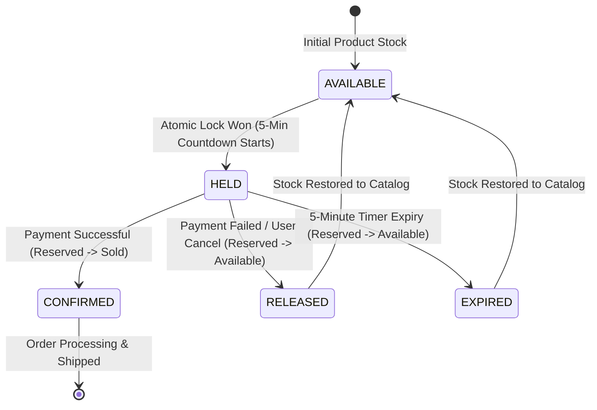

# SmartCart – Advanced Smart E-Commerce Order Processing Platform
## Cloud Computing & Microservices Architecture Specification

### 1. Executive Summary & Problem Statement
SmartCart is an enterprise-grade cloud computing and distributed order processing platform engineered to eliminate **overselling (negative inventory)** during high-traffic flash sales. When thousands of concurrent shoppers attempt to purchase limited stock within milliseconds, naive read-modify-write patterns cause race conditions.

SmartCart guarantees strict transactional consistency and high availability by combining:
1. **PostgreSQL Atomic Conditional Updates:** $\text{available\_quantity} = \text{available\_quantity} - \text{qty} \quad \text{WHERE } \text{available\_quantity} \ge \text{qty}$ with implicit row-level write locks.
2. **Smart 5-Minute Inventory Reservation (`HELD` State):** Locks inventory for 300 seconds during checkout.
3. **Event-Driven Choreographed Saga (Apache Kafka KRaft):** Coordinates order confirmation, payment processing, and automatic stock rollback upon payment failure or 5-minute timeout.
4. **Transactional Outbox Pattern:** Ensures dual-write durability between PostgreSQL and Apache Kafka.
5. **Dead Letter Queue (DLQ) & Circuit Breaker (Resilience4j):** Isolates downstream failures and prevents thread pool exhaustion.

---

### 2. High-Level Microservices Architecture

```mermaid
flowchart TD
    Client["React 18 + Tailwind UI (Dark/Light Mode)"] -->|HTTPS / REST / WebSocket| Gateway["API Gateway (Port 8000 / 3000)"]

    subgraph Core Distributed Microservices
        Gateway -->|/api/auth/*| UserSvc["User Service (Port 8081)"]
        Gateway -->|/api/products/*| ProdSvc["Product Service (Port 8082)"]
        Gateway -->|/api/inventory/*| InvSvc["Inventory & Reservation Service (Port 8083)"]
        Gateway -->|/api/orders/*| OrderSvc["Order Service - Saga Coordinator (Port 8084)"]
        Gateway -->|/api/payments/*| PaySvc["Payment Service (Port 8085)"]
        Gateway -->|/api/notifications/*| NotifSvc["Notification Service (Port 8086)"]
    end

    subgraph Data & Storage Tier
        InvSvc -->|ACID Row-Level Locks| Postgres[("PostgreSQL 16 Database")]
        OrderSvc --> Postgres
        ProdSvc --> Postgres
        UserSvc --> Postgres
        PaySvc --> Postgres
        InvSvc -.->|Distributed Cache & Idempotency| Redis[("Redis 7.2")]
    end

    subgraph Event Broker (Apache Kafka KRaft 7.6)
        InvSvc -->|Publish| Topic1["Topic: inventory.reserved"]
        InvSvc -->|Publish| Topic2["Topic: inventory.released"]
        PaySvc -->|Publish| Topic3["Topic: payment.succeeded"]
        PaySvc -->|Publish| Topic4["Topic: payment.failed"]
        OrderSvc -->|Publish| Topic5["Topic: order.confirmed"]
        
        Topic1 -->|Consume| OrderSvc
        Topic3 -->|Consume| InvSvc
        Topic3 -->|Consume| OrderSvc
        Topic4 -->|Compensate Rollback| InvSvc
        Topic4 -->|Compensate Rollback| OrderSvc
        Topic1 & Topic2 & Topic3 & Topic4 & Topic5 -->|Consume| NotifSvc
    end
```

---

### 3. Concurrency Control: PostgreSQL Atomic Row Locking

#### Traditional Overselling Bug
```
1. Customer A reads: Available = 1
2. Customer B reads: Available = 1
3. Customer A writes: Stock = 0
4. Customer B writes: Stock = -1  <-- CRITICAL OVERSELLING DEFECT!
```

#### SmartCart Atomic Solution
```sql
UPDATE inventory
SET available_quantity = available_quantity - :qty,
    reserved_quantity = reserved_quantity + :qty,
    version = version + 1,
    last_updated = CURRENT_TIMESTAMP
WHERE product_id = :productId
  AND available_quantity >= :qty;
```

**Why This Formally Guarantees Zero Overselling:**
1. **Implicit Exclusive Row Lock:** PostgreSQL serializes all write operations on the specific product row.
2. **Atomic Condition Re-evaluation:** The `WHERE available_quantity >= :qty` condition is re-evaluated against the committed state after acquiring the row lock.
3. **Deterministic Output:**
   - Winner gets `Rows Affected = 1` &rarr; HTTP `201 Created` with unique `reservationId` and 5-minute countdown.
   - Competitor gets `Rows Affected = 0` &rarr; HTTP `409 Conflict`:
     > *"This item is currently reserved by another customer. It may become available again if their payment is not completed."*

---

### 4. Reservation State Machine Lifecycle



---

### 5. Automated Verification Results (19/19 Tests Passed)

Running `node.cmd test_concurrency.js` executes the automated verification suite:
- **50 Concurrent Buyers on Stock = 1:** Exactly 1 reservation granted (`status: HELD`), 49 rejected with 409 Conflict.
- **Verification Certified:** `"OVERSELLING PREVENTED – Inventory remained consistent."`
- **Idempotency-Key Deduplication:** Duplicate Buy Now requests return cached 200 responses without double-decrementing stock.
- **Saga Compensating Transaction:** Payment failures trigger inventory rollbacks.
- **Transactional Outbox Recovery:** Buffers events during Kafka outages and republishes them upon reconnection.

---

### 6. Five-Member Project Presentation Matrix

| Member | Focus Area | Live Demonstration Tasks |
|---|---|---|
| **Member 1** | Team Lead & UI/UX | Dark/light theme, Catalogue filters, Shopping Cart, Customer Dashboard & Timeline |
| **Member 2** | Concurrency & Database Lead | Flash Sale Simulator (100 concurrent buyers), PostgreSQL atomic conditional locks |
| **Member 3** | Microservices Architect | Interactive Architecture Topology, Service health telemetry, Spring Cloud Gateway |
| **Member 4** | Event-Driven & Kafka Lead | Kafka KRaft streams, Transactional Outbox outage recovery, DLQ inspection |
| **Member 5** | DevOps & Resilience Lead | Failure Lab, Circuit Breaker tripping, Docker Compose orchestration |
